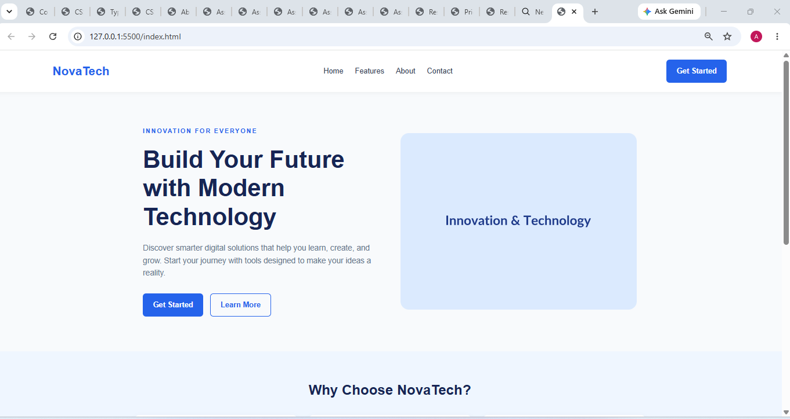
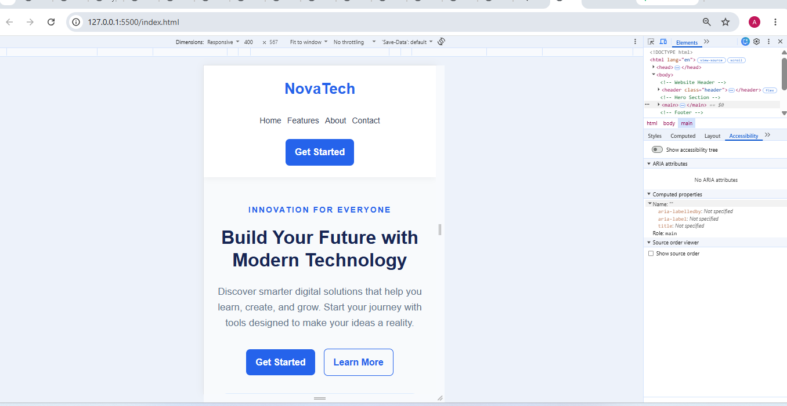

# Assignment 7.4 — Modern Landing Page Header

## 1. Aim

To design a modern landing page containing a header, navigation links, a call-to-action (CTA) button, a hero section with text and an illustration, and a footer using HTML, CSS, and Flexbox.

## 2. Requirements

- Visual Studio Code
- A web browser
- Basic knowledge of HTML and CSS

## 3. Theory

A landing page is a webpage designed to introduce a product, service, or organization and encourage visitors to take a specific action.

Flexbox is a CSS layout model that arranges elements in rows or columns. It helps position navigation links, align text and images side-by-side, and create responsive layouts.

A CTA button encourages users to perform an action, such as getting started or learning more. Media queries help adjust the page for different screen sizes.

## 4. Procedure

1. Create a folder named `Assignment-7.4`.
2. Create an `index.html` file.
3. Add a header containing a logo, navigation links, and a CTA button.
4. Create a hero section with a heading, paragraph, and buttons.
5. Add an illustration to the hero section.
6. Create a `style.css` file.
7. Use Flexbox to arrange the hero text and image side-by-side.
8. Style the header, buttons, hero section, and footer.
9. Add a media query to make the layout responsive.
10. Open the webpage in a browser and test different screen widths.

## 5. Explanation of CSS Properties

| Property                         | Purpose                                                           |
| -------------------------------- | ----------------------------------------------------------------- |
| `display: flex`                  | Arranges elements in a flexible layout.                           |
| `justify-content: space-between` | Distributes space between header elements.                        |
| `align-items: center`            | Aligns items along the cross axis.                                |
| `flex-direction: column`         | Stacks elements vertically on smaller screens.                    |
| `flex-wrap: wrap`                | Allows elements to move onto another line.                        |
| `gap`                            | Adds space between elements.                                      |
| `flex: 1 1 50%`                  | Allows hero content and image to grow or shrink from a 50% basis. |
| `clamp()`                        | Adjusts the heading size within specified limits.                 |
| `@media`                         | Applies responsive styles at selected viewport widths.            |

## 6. Testing and Observation

1. Open `index.html` in a browser.
2. Check that the logo, navigation links, and CTA button appear in the header.
3. Verify that the hero text and image appear side-by-side on a desktop.
4. Resize the browser to a width of approximately 375 pixels.
5. Check that the hero text appears above the image on mobile.
6. Verify that the buttons, feature cards, and footer remain readable.
7. Test the navigation links and CTA buttons.

**Observation:** Flexbox aligns the header and hero content. Media queries change the layout on smaller screens, improving usability on mobile devices.

## 7. Result

A modern landing page with a navigation header, CTA buttons, hero section, illustration, features section, and footer was successfully created using HTML and CSS Flexbox.

## 8. Conclusion

This assignment demonstrates the use of Flexbox, alignment properties, CTA buttons, and responsive media queries to create a modern landing page that adapts to desktop and mobile screens.

## SCREEN SHOT DESKTOP VIEW

## SCREENSHOT MOBILE VIEW

